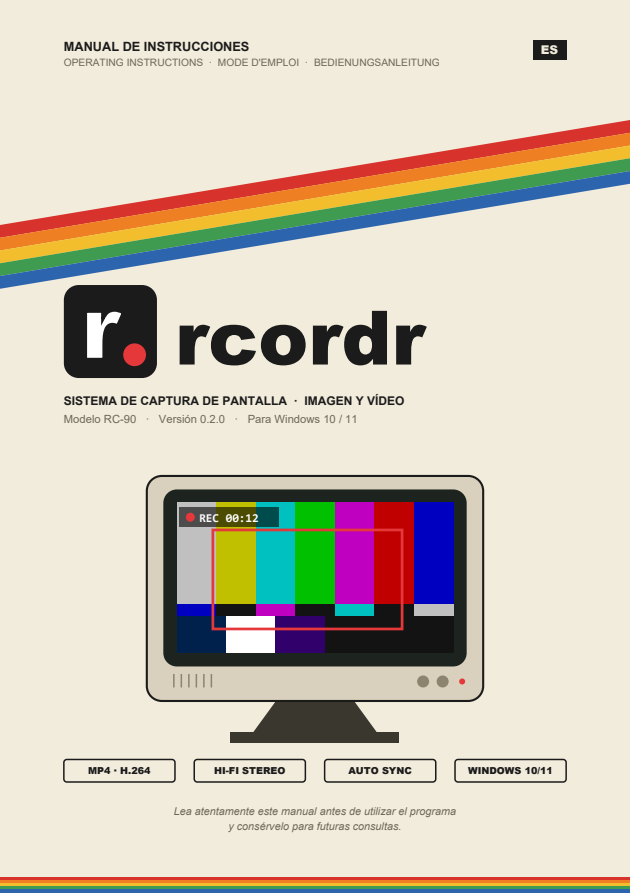
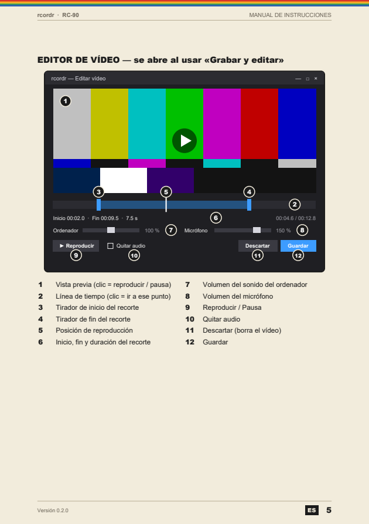

<p align="center">
  
</p>

<h1 align="center">rcordr</h1>

<p align="center">
  Captura y graba tu pantalla en Windows con un atajo de teclado, y compártelo por WhatsApp al instante.<br>
  <sub>A tiny, local screen capture and recording tool for Windows: screenshots, video, system audio and microphone.</sub>
</p>

<p align="center">
  <a href="LICENSE"></a>
  
  
</p>

<p align="center">
  <a href="docs/manual.pdf"></a>
  &nbsp;
  <a href="docs/manual.pdf"></a>
  <br><sub>Incluye <a href="docs/manual.pdf">manual de instrucciones en PDF</a>, al estilo de las videocámaras de los 80–90.</sub>
</p>

---

rcordr vive en la bandeja del sistema, junto al reloj, como una **r** blanca con un punto
rojo. No tiene ventana principal: todo se hace con tres atajos de teclado.

- **Captura de imagen** de la zona que elijas, copiada al portapapeles al momento y con un
  botón flotante para guardarla en PNG.
- **Grabación de vídeo** de una zona o de la pantalla completa, en MP4 listo para WhatsApp
  y copiado al portapapeles como archivo (`Ctrl+V` en el chat).
- **Sonido del ordenador y micrófono**, mezclados y sincronizados automáticamente.
- **Editor** al terminar de grabar: recortar inicio y fin, ajustar el volumen de cada
  fuente y quitar el audio.
- **100 % local**: sin cuentas, sin conexión a Internet y sin permisos de administrador.

## Descarga

1. Descarga `rcordr-<versión>-windows.zip` desde
   [**Releases**](https://github.com/aydearcas/rcordr/releases).
2. Descomprímelo en una carpeta permanente y abre **`rcordr.exe`**. No necesita instalación
   ni Python.
3. La primera vez Windows puede mostrar «Windows protegió su PC», porque el ejecutable no
   está firmado: pulsa **Más información → Ejecutar de todas formas**.

El paquete incluye el [manual de instrucciones](docs/manual.pdf), con la instalación paso a
paso, todas las opciones y la solución de problemas.

## Uso

| Atajo | Acción |
|---|---|
| `Ctrl+Shift+1` | **Captura de imagen.** La pantalla se congela: arrastra para seleccionar (clic = pantalla completa, `Esc` = cancelar). Se copia al portapapeles y aparece **Guardar** (PNG). |
| `Ctrl+Shift+2` | **Grabar vídeo.** Elige la zona igual que en la captura. Mientras graba, un marco rojo rodea la zona y abajo a la derecha se ve `● REC 00:12` (ninguno de los dos sale en el vídeo). Vuelve a pulsarlo para **detener**. |
| `Ctrl+Shift+3` | **Grabar y editar.** Igual, pero al detener se abre el editor. |

Clic en el icono de la bandeja: captura. Clic derecho: menú con las mismas acciones, las
carpetas de capturas y vídeos, **Configuración** y **Salir**.

### Sonido

En **Configuración** se marca qué se graba:

- **Sonido del ordenador** (activado de fábrica): lo que suena por la salida predeterminada.
- **Micrófono**: la entrada predeterminada de Windows.

Si están los dos, se mezclan en una sola pista.

> Si el micrófono predeterminado son unos auriculares Bluetooth, Windows los pasa a modo
> «manos libres» mientras se graba y el sonido del ordenador pierde calidad.

### Editor

- Arrastra los **extremos azules** de la línea de tiempo para recortar (o `I` / `O` en la
  posición actual). `Espacio` reproduce o pausa.
- **Mezclador** con un volumen de 0 a 200 % para el ordenador y otro para el micrófono. Se
  escucha al momento y se recuerda para las siguientes grabaciones.
- **Quitar audio**, **Guardar** (sustituye la grabación), **Descartar** (la borra, pide
  confirmación) o cerrar la ventana (conserva el vídeo completo).

Al grabar para editar, cada fuente de audio va en su propia pista, ya sincronizada, y al
guardar se mezclan en una sola.

### Dónde se guarda

| | |
|---|---|
| Capturas | `Imágenes\rcordr\captura_AAAAMMDD_HHMMSS.png` |
| Vídeos | `Vídeos\rcordr\video_AAAAMMDD_HHMMSS.mp4` |
| Ajustes | `%USERPROFILE%\.rcordr\config.json` (atajos, carpetas, fps, volúmenes) |
| Registro de errores | `%USERPROFILE%\.rcordr\rcordr.log` |

## Formato de vídeo

**MP4 con vídeo H.264 (yuv420p) y audio AAC estéreo**, con `faststart`: es el formato
nativo de WhatsApp en Android, iPhone, Web y Desktop, así que se envía y reproduce sin
conversión. El vídeo se limita a 1080 líneas y se comprime con CRF 26: unos 2–10 MB por
minuto según el movimiento en pantalla.

<details>
<summary>Otros formatos y por qué no se usan</summary>

| Formato | WhatsApp | Comentario |
|---|---|---|
| **MP4 (H.264 + AAC)** | ✅ En todas partes | El elegido. |
| 3GP | ✅ | Formato antiguo, peor calidad. |
| MOV (H.264 + AAC) | ⚠️ Normalmente | En Android/Web a veces se envía como documento. |
| MP4 (H.265/HEVC) | ⚠️ Depende del móvil | Ocupa menos, pero no todos lo reproducen. |
| WebM / MKV | ❌ | Se envía como documento. |

</details>

## Desde el código

Requisitos: Windows 10 (2004 o posterior) u 11 y Python 3.10 o posterior.

```powershell
git clone https://github.com/aydearcas/rcordr.git
cd rcordr
powershell -ExecutionPolicy Bypass -File instalar.ps1
```

`instalar.ps1` crea el entorno virtual, instala las dependencias verificando sus hashes y
añade un acceso directo en el menú Inicio. Opciones: `-Escritorio` (icono en el escritorio)
e `-Inicio` (arrancar con Windows).

<details>
<summary>Instalación manual y diagnóstico</summary>

```powershell
python -m venv .venv
.venv\Scripts\pip install --require-hashes --only-binary=:all: -r requirements.txt
.venv\Scripts\pythonw rcordr.pyw
```

`pythonw rcordr.pyw --selftest` (o `rcordr.exe --selftest`) comprueba la ventana, ffmpeg y
el audio grabando 2 segundos, y deja el resultado en
`%USERPROFILE%\.rcordr\rcordr-selftest.log`.

</details>

### Empaquetar

Genera `dist\rcordr-<versión>-windows.zip` con el ejecutable portable, el manual y las
licencias, y actualiza `docs\`:

```powershell
uv venv .venv-build --python 3.13 --python-preference only-managed
uv pip install --python .venv-build\Scripts\python.exe --require-hashes -r scripts\requirements-build.txt
.venv-build\Scripts\python.exe scripts\empaquetar.py
```

Se compila con PyInstaller y un Python gestionado por `uv` (el de Microsoft Store da
problemas al empaquetar). `--solo-manual` regenera solo el manual.

### Cómo funciona

```
rcordr/
  app.py         bandeja (pystray), bucle de Tk, coordinación y --selftest
  hotkeys.py     atajos globales con RegisterHotKey (Win32, sin permisos de admin)
  screenshot.py  selección de zona sobre la pantalla congelada (mss + Tk)
  recorder.py    vídeo con ffmpeg gdigrab + audio del ordenador (loopback) y micrófono
  editor.py      vista previa, recorte, mezclador de volumen y quitar audio
  ui.py          paneles flotantes: Guardar, indicador REC, avisos, marco de la zona
  winapi.py      portapapeles, DPI, instancia única, ventanas ocultas en las capturas
  icon.py        dibuja el icono
  config.py      config.json
scripts/
  empaquetar.py  ejecutable portable + manual + licencias en un .zip
  manual.py      manual de instrucciones en PDF (reportlab)
```

- El vídeo se graba a un `.mkv` temporal y cada fuente de audio a su propio `.raw`. Al
  parar se combinan en el `.mp4` sin recodificar el vídeo, así que es casi instantáneo.
- **Sincronía:** ffmpeg informa la hora real del primer fotograma (`start:`) y se compara
  con la hora de inicio de cada fuente de audio para recortarla o retrasarla.
- El loopback de WASAPI no entrega datos mientras no suena nada; para que el audio no se
  desincronice, se reproduce silencio en esa misma salida mientras se graba.
- PortAudio no admite que dos hilos lo inicialicen a la vez: todas sus llamadas de control
  pasan por un candado.
- Los paneles flotantes usan `WDA_EXCLUDEFROMCAPTURE`, así que no salen en las capturas.

## Seguridad y privacidad

- **No usa la red** ni necesita permisos de administrador.
- Los atajos usan `RegisterHotKey`: rcordr solo recibe sus tres combinaciones y no ve el
  resto de lo que escribes (no es un gancho de teclado).
- Las dependencias están fijadas con **hashes SHA-256** (`requirements.txt`) y se instalan
  con `--require-hashes --only-binary=:all:`. Para actualizarlas, edita `requirements.in` y
  ejecuta `uv pip compile requirements.in --generate-hashes --python-platform windows -o requirements.txt`.
- Siempre se usa el ffmpeg del paquete verificado: no se busca en el `PATH`.
- Al abrirse, rcordr vacía su carpeta temporal. Si una grabación quedó a medias por un
  cierre inesperado, la recupera (sin sonido) como `video_recuperado_*.mp4`.
- Ten en cuenta que, si tienes activado el historial del portapapeles (`Win+V`), Windows
  guarda ahí las capturas, y que el sonido del ordenador incluye la voz de los demás en
  una llamada.

## Licencia

Copyright © 2026 Aythami de Armas Castellano.

rcordr es software libre: puedes redistribuirlo y modificarlo bajo los términos de la
**GNU General Public License v3** o, a tu elección, cualquier versión posterior. Se ofrece
sin ninguna garantía. Consulta [LICENSE](LICENSE).

El paquete portable incluye componentes de terceros con sus propias licencias, entre ellos
FFmpeg (GPL v3), pystray (LGPL v3), PyAudioWPatch (Apache-2.0), Pillow y mss. La lista
completa, con enlaces al código fuente, está en
[THIRD_PARTY_NOTICES.md](THIRD_PARTY_NOTICES.md).
